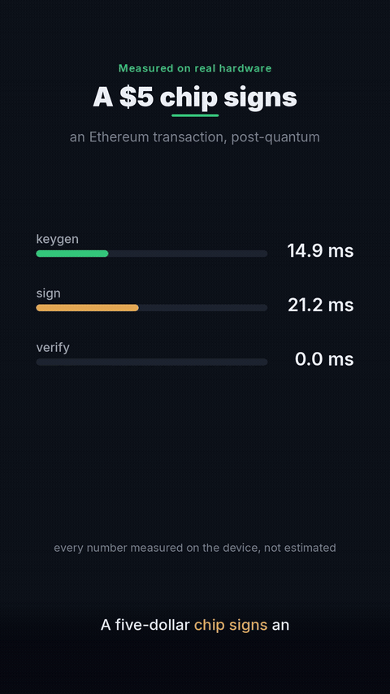

# pq-zk — post-quantum signatures for Ethereum, proven in a zkVM

A $5 ESP32-S3 signs Ethereum transactions with **ML-DSA-44 (FIPS 204)**. The lattice
verification runs inside an [SP1](https://github.com/succinctlabs/sp1) zkVM and lands
on-chain as a Groth16 proof — **37.2× cheaper** than verifying the same signature
directly in the EVM, with the 2-of-2 hybrid account policy intact.



## Measured results

Every number below traces to a live Sepolia transaction or an on-device measurement.

| | |
|---|---|
| On-device (ESP32-S3 @ 240 MHz) | keygen **16.2 ms** · sign **47.8 ms** · verify **16.4 ms** |
| Signature overhead | 65 B (ECDSA) → **2,420 B** (ML-DSA-44), pk 1,312 B |
| Stack reality | ML-DSA-44 peaks at **52.7 KB** of stack — a 32 KB task crashes the firmware |
| Direct on-chain ML-DSA verify | **8,272,903 gas** — live tx [0x1792…7321](https://sepolia.etherscan.io/tx/0x1792ed3acfb70f0a294d96ce90440836742f45653619985087b44d07e91c7321) |
| Same verify as a Groth16 proof | **222,469 gas** — **37.2× cheaper** (≈230K incl. public-values hashing) |
| zkVM guest | 2,738,446 RISC-V cycles to verify the lattice signature |
| Cost to prove | **~13–14 GB RAM** peak — documented across 5 proving environments |

## Why this exists

Quantum computers break ECDSA — the one signature every hardware wallet uses today.
The migration path that works *without waiting for protocol changes*: an ERC-4337
smart account whose policy is **2-of-2** — a hot secp256k1 key *and* an ML-DSA-44 key
held on a $5 board. Steal either one alone and the account says no. The only problem
with putting lattice math in Solidity is that it costs ~8.3M gas — so the zkVM does
the verification off-chain and the chain checks a constant-size proof instead.

## Architecture

```
ESP32-S3 (ML-DSA-44 + Ed25519, BOOT-button WYSIWYS signing over UART)
        │  pk · sig · userOpHash
        ▼
SP1 zkVM guest (this repo, program/) — RustCrypto ml-dsa verify in RISC-V
        │  Groth16 proof + public values (ok, userOpHash, pk)
        ▼
HybridAccountZK (ERC-4337 v0.7) — ecrecover leg + SP1Verifier.verifyProof leg
        │  binds: ok==true ∧ pv.userOpHash==userOpHash ∧ pv.pk==registered key
        ▼
Ethereum Sepolia
```

The guest commits `(ok, userOpHash, pk)` as public values, so a replayed proof for a
different operation or a different key is rejected on-chain.

## Layout

- `program/` — the zkVM guest: ML-DSA-44 verification, FIPS 204 pure mode
- `lib/` — shared public-values ABI
- `script/` — prover client (execute / core / groth16 modes)
- `fib-demo/` — minimal program demonstrating the Groth16 gas program-independence
- `run-prove.sh` — prover runner with the real memory knobs
  (`ELEMENT_THRESHOLD` / `HEIGHT_THRESHOLD` — the default shard hints don't help)
- `COLAB.md`, `CODESPACE.md`, `KAGGLE.md` — proving runbooks for 8–13 GB environments

## Quickstart

```sh
# install SP1: https://docs.succinct.xyz/docs/sp1/getting-started/install
cd script
cargo run --release -- --execute     # run the guest without proving
cargo run --release                  # generate a core proof
```

Proving the full guest needs ~13–14 GB RAM (see the runbooks for smaller hosts).

## The smart account side

Contracts, deployment registry, and the full research report live in
**[pq-account](https://github.com/muhammadsohaimmuqtada/pq-account)** —
`HybridAccountZK.sol`, the 2-of-2 validation logic, the gas-measurement harness,
and the complete write-up ([REPORT.md](https://github.com/muhammadsohaimmuqtada/pq-account/blob/main/REPORT.md))
covering the threat model, the embedded engineering war stories, and the memory analysis.

## On-chain receipts (Sepolia)

| | tx | gas |
|---|---|---|
| Direct ML-DSA verify (block 11,778,483) | [0x1792…7321](https://sepolia.etherscan.io/tx/0x1792ed3acfb70f0a294d96ce90440836742f45653619985087b44d07e91c7321) | 8,272,903 |
| Groth16 verifyProof | [0xee02…cfce](https://sepolia.etherscan.io/tx/0xee029472ebc1eec25473cd0bbc7772fddda07aff1305abc5a131da8a981ecfce) | 222,469 |

## License

MIT — see [LICENSE-MIT](LICENSE-MIT).
